# Future workflow: from email request to response

*Copy this file to `FUTURE_WORKFLOW.md` at your repository root, link it from `APPROACH.md`, and fill in every section. Keep the section headings, the stage IDs and the fixed values exactly as given. Content outside this template is not read for the workflow.*

---

## 1. Diagram

```mermaid
flowchart LR
    IN[Email + attachments] --> S1[S1 Intake]
    S1 -- "text + files" --> S2[S2 Extraction]
    S2 -- "facts + question" --> S3[S3 Identity]
    S3 -- "folio, investor, txn" --> S4[S4 Policy]
    S4 -- "document + version" --> S5[S5 Checks]
    S5 -- "check results" --> S6[S6 Outcome]
    S6 -- "outcome + reason codes" --> S7[S7 Reply]
    S7 -- "draft reply" --> S8[S8 Trace]
    S8 -- "response + trace" --> OUT[Response]
    S8 --> S9[S9 Human review]
    S9 -- "approve / correct reply" --> OUT

    S1 -- "unreadable attachment" --> S9
    S2 -- "model unavailable -> rules only" --> S3
    S2 -- "low confidence" --> S9
    S3 -- "folio not found" --> S6
    S4 -- "no applicable document" --> S6
    S5 -- "source unavailable" --> S6
    S6 -- "cannot confirm payment -> PEND" --> S7
    S6 -- "FAIL without evidence" --> S9
    S7 -- "wording needs polish" --> S9
```

Failure notes:

- S2: the model call lives in `src/llm.py` behind a guard; if the model is unavailable the rules in `src/intake.py` run alone.
- S6: on Render, Groq calls return HTTP 403; a model attempt waits up to 20 seconds.
- S6: many requests use folios with no pending register row, so the service answers `PEND` because it cannot confirm the payment.
- S6: `KYC_REGISTERED_NEW_AMC` is missing on new-folio requests.
- S5: some `FAIL` results lack evidence.
- S9: not built.

---

## 2. Stages

| stage | what has to happen | mechanism | component / tool | input → output | on failure | built? |
|---|---|---|---|---|---|---|
| S1 | Take in the request: email text and attachments, including scans | `RULE` | `src/intake.py` | email + attachments → request text and files | Unreadable or unparseable input goes to S9 | BUILT: `src/intake.py` |
| S2 | Work out what is being asked and pull out the facts the checks need | `RULE` first, then one guarded `LLM` call | `src/intake.py` rules plus one model call in `src/llm.py` | request text → facts and question | Model unavailable (Groq HTTP 403, attempt waits up to 20 seconds) → rules only; low confidence → S9 | BUILT: `src/intake.py`, `src/llm.py` |
| S3 | Identify the folio, investor and transaction in the records | `RULE` | `src/checks.py` | facts → folio, investor, transaction | Folio not found → S6 with a can't-confirm outcome | BUILT: `src/checks.py` |
| S4 | Find the rules that apply to this request (right document, version and client) | `RULE` | `src/data.py` `select_policy` | request + `received_at` → policy document | No applicable document → S6 | BUILT: `src/data.py` `select_policy` |
| S5 | Run the checks | `RULE` | `src/checks.py` | records + policy → check results | Source unavailable → S6 | BUILT: `src/checks.py` |
| S6 | Decide the outcome, reason codes and approval | `RULE` | `src/outcome.py` | check results → outcome, reason codes, `decision_basis`, `review_flags` | Cannot confirm payment → `PEND`; `FAIL` without evidence → S9 | BUILT: `src/outcome.py` |
| S7 | Draft the reply | `RULE` (+ `LLM` for wording) | `src/outcome.py` | outcome → `draft_status`, reply text | Wording needs polish → S9 | BUILT: `src/outcome.py` |
| S8 | Record what was used and decided (audit trail and `trace`) | `RULE` | `src/solution.py` | outcome + rules used → response with `trace`, `notes` | Storage is not persistent; no persistent audit trail | BUILT: `src/solution.py` |
| S9 | Human review and approval | `HUMAN` | review screen (not built) | draft + `review_flags` → approved reply | No screen exists, so requests needing a person are not actioned | DESIGNED_NOT_BUILT: human review screen and persistent audit storage are not built |

---

## 3. Checks (detail of S5)

| check | data it reads | how it decides (mechanism and rule) | SOP clause | result when its source is unavailable |
|---|---|---|---|---|
| Folio format | transactions | `RULE`: folio must be `NNNNNNNN/NN`; 56 were not | SOP v4.1 | Cannot confirm → `PEND` |
| Date parsing | transactions, KRA, mandates | `RULE`: dates accepted as `dd-mm-yyyy`; 53 were | SOP v4.1 | Cannot confirm → `PEND` |
| Duplicate payment | transactions | `RULE`: duplicate pairs sharing a UTR flagged; 4 pairs found | SOP v4.1 | Cannot confirm → `PEND` |
| KRA status | KRA rows | `RULE`: status from code when text blank (6 rows); leading zeros restored (8 codes) | SOP v4.1 | Cannot confirm → `PEND` |
| PAN and name consistency | folios, KRA | `RULE`: one PAN spanning several folios and differently written names flagged | SOP v4.1 / TMF-ADD-02 | Cannot confirm → `PEND` |
| Payment confirmation | pending register | `RULE`: match payment to a pending register row | SOP v4.1 | No row → `PEND` (cannot confirm payment) |
| New-folio KYC | KRA rows | `RULE`: `KYC_REGISTERED_NEW_AMC` expected on new-folio requests; it is missing | SOP v4.1 | Cannot confirm → `PEND` |
| Bank mandate | bank mandates | `RULE`: mandate present and consistent with folio | SOP v4.1 | Cannot confirm → `PEND` |

---

## 4. Where people stay in the loop

| decision or action | who (role) | what they see when asked | why a person (SOP clause or risk) | could it be automated later? on what evidence? |
|---|---|---|---|---|
| Approve or correct a reply the system proposes | Checker | Draft reply, `draft_status`, `review_flags`, `decision_basis`, check results | Reply wording needs polish; a bad reply goes to a distributor | Yes, once wording is polished and evaluated |
| Resolve a `FAIL` that lacks evidence | Checker | Flagged check and the trace | Some `FAIL` results lack evidence | Yes, once checks always attach evidence |
| Decide requests the service answers `PEND` | Maker / checker | Folio with no pending register row, so payment cannot be confirmed | Cannot confirm the payment from records | Yes, if an authoritative payment source is added |
| Handle new-folio KYC where `KYC_REGISTERED_NEW_AMC` is missing | Maker | Request plus missing check | Missing required KYC code | Yes, once the code is available |
| Approve the human-review screen and persistent audit storage | Owner | Design for S9 and storage | S9 and persistent audit storage are designed but not built | Yes, when built |
