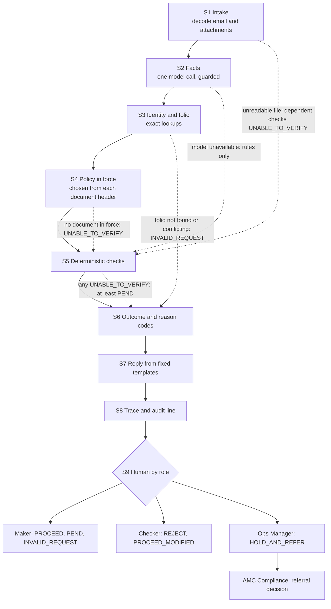

# Future Workflow

## 1. Diagram

## 2. Stages

| stage | what has to happen | mechanism | component / tool | input to output | on failure | built? |
| --- | --- | --- | --- | --- | --- | --- |
| S1 Intake | Decode the request and read PDF, Word, Excel and plain text; keep images for the model; apply size and count limits; never raise. | RULE | `src/intake.py` | raw email and attachments to normalised text, attachment list, limits applied | An unreadable file leaves the dependent checks UNABLE_TO_VERIFY. | BUILT: `src/intake.py` |
| S2 Facts | One LLM call for facts only. Model order: Gemini 3.1 Flash Lite, then 3.5 Flash Lite, then Groq Qwen3.8-27B, then gpt-oss-120b. Document text is treated as data. 12 s per attempt and 25 s overall budget. Then a guard drops facts not found in the text. | RULE then one LLM call | `src/intake.py` extractor, `src/llm.py`, `guard_facts` | normalised text to structured facts | If every model fails the run continues rule-based. | BUILT: `src/intake.py` (extractor), `src/llm.py`, `guard_facts` |
| S3 Identity and folio | Exact lookups in the store; match folio and the pending transaction of the same kind. | RETRIEVAL and RULE | `src/data.py` DataStore, `src/checks.py` `evaluate` | facts to resolved folio and pending transaction | A folio not found, or conflicting, is INVALID_REQUEST. | BUILT: `src/data.py`, `src/checks.py` `evaluate` |
| S4 Policy in force | Select by the document's own header: status, effective date and fund house against received_at. SOP v4.1, plus TMF-ADD-02 for TMF; v3.2 never. | RETRIEVAL | `src/data.py` `select_policy` | received_at and fund house to policy in force | No document in force gives UNABLE_TO_VERIFY. | BUILT: `src/data.py` `select_policy` |
| S5 Checks | Run the eight deterministic checks and record each result. | RULE | `src/checks.py` | facts, records and policy to per-check results | Any UNABLE_TO_VERIFY drives the outcome to at least PEND. | BUILT: `src/checks.py` |
| S6 Outcome | Decide the outcome in fixed order, list every reason code and set the approver. An assertion requires that PROCEED needs every check PASS or NOT_APPLICABLE. | RULE | `src/outcome.py` `decide` | check results to outcome, reason codes and approver | The assertion stops the run rather than emitting PROCEED. | BUILT: `src/outcome.py` `decide` |
| S7 Reply | Fill a fixed template. No model writes replies. | RULE only | `src/outcome.py` | outcome to draft reply | An unknown outcome falls back to a safe generic draft. | BUILT: `src/outcome.py` |
| S8 Trace | Record the real tools, documents and model calls, the cost, and an audit line with no email bodies. | RULE | `src/solution.py`, `build/case_log.jsonl` | outcome and reply to trace and audit line | If the trace cannot be written, a minimal audit line is still emitted. | BUILT: `src/solution.py` |
| S9 Human by role | A person reviews by role. The service returns approver_role and draft_status only. | HUMAN | designed hand-off | draft and approver role to human decision | Not built; the service hands off. | DESIGNED_NOT_BUILT |

## 3. Checks

| check | data it reads | how it decides | SOP clause | result when its source is unavailable |
| --- | --- | --- | --- | --- |
| FOLIO_IDENTITY | `folio_master.csv` | Exact lookup of the canonical folio. None quoted, unknown, two different folios, or a scheme of the other fund house is INVALID_REQUEST. | SOP 9.4 | UNABLE_TO_VERIFY |
| KYC_STATUS | `kra_kyc_snapshot.csv` | Status is the last two digits of the KRA code. A lookup older than 24 hours is unable. Validated passes. Registered passes except a new folio at a fund house where the PAN holds none, which is PEND. On Hold or Rejected is REJECT on a purchase and HOLD_AND_REFER on a redemption. | SOP 4.2-4.5 | UNABLE_TO_VERIFY and PEND |
| THIRD_PARTY_PAYMENT | `transactions.csv`, `bank_mandates.csv`, attachments | The paying account must be registered and validated with the first holder, or a minor's guardian, as holder. An own unregistered account needs a matching statement. Employer payers need every listed document attached. Any other payer is REJECT. | SOP 5.1, 5.3, 5.4, 5.6, 5.7 | No matching pending transaction gives UNABLE_TO_VERIFY |
| BANK_MANDATE | `bank_mandates.csv` | A redemption pays only to a registered validated account. A named pending or unregistered account is disregarded and the default used (PROCEED_MODIFIED). A change of bank needs proof of the new and existing account, mandatory for TMF. | SOP 6.2, 6.3, TMF-ADD-02 A2 | UNABLE_TO_VERIFY |
| COB_COOLING | `bank_mandates.csv`, `folio_master.csv` | A bank change within 10 days of the redemption holds the payout. A mobile or email change in the 30 days before it gives HOLD_AND_REFER. | SOP 6.4, 6.5 | UNABLE_TO_VERIFY |
| DISTRIBUTOR_CODE | `distributor_master.csv` | Regular plan only: the ARN must exist, be active, unexpired and empanelled with the fund house, else PROCEED_MODIFIED to Direct. A blank EUIN adds EUIN_MISSING. | SOP 7.2, 7.3 | UNABLE_TO_VERIFY |
| MINOR_RULES | `folio_master.csv` | Majority at 18 means PEND. Only the minor, a parent or the guardian may pay. | SOP 5.4, 5.5 | UNABLE_TO_VERIFY |
| REFERRAL | `folio_master.csv`, `transactions.csv` | STOP_LOCK. A TMF redemption of Rs 5,00,000 or more within 30 days of a purchase. Purchase and redemption each Rs 25,00,000 or more within 14 days. Cash above Rs 50,000 per PAN, fund house and financial year is REJECT. | SOP 8.3, 8.4, 8.5, TMF-ADD-02 A1 | UNABLE_TO_VERIFY |

## 4. Where people stay in the loop

| decision or action | who | what they see | why a person, with the clause | could it be automated later |
| --- | --- | --- | --- | --- |
| Approve REJECT and PROCEED_MODIFIED | Checker | Annexure A, the evidence and the draft reply | A second pair of eyes on outcomes that reject or change a request. | Later automatable for rule-only cases such as KYC On Hold after a long run of agreement. |
| Approve a payout hold | Ops Manager | The hold reason, the cooling-period evidence and the draft reply | A hold touches money movement and needs accountable sign-off. | Not automatable. |
| Decide on a referral | AMC Compliance | The referral reason codes and the underlying records | Regulatory and AML judgement sits with Compliance. | Not automatable. |
| Release PROCEED, PEND and INVALID_REQUEST replies; follow up documents | Maker | The draft reply and the reason codes | The maker owns the client relationship and the chase for documents. The checker samples 10% of PROCEED. | Partly, once agreement is stable. |
| Handle OTHER requests and review_flags | Maker | The request, the flags and SOP 2.2 | Other request types need a human routing decision. | Not yet. |

## 5. Impact

| band | % of daily requests | basis |
| --- | --- | --- |
| Fully automatic | about 78% | CURRENT_WORKFLOW.docx says about 1,800 requests a day and 22% need a second touch; we read that as the share needing a checker or manager and split it 2:1 using the 18 pending register rows. |
| Person confirms the system's proposal | about 15% | Same split. These are estimates. |
| Person decides | about 7% | Same split. These are estimates. |

**Expected maker and checker minutes per request after the change:** the desk lead's example is 12 minutes of which about 9 are lookups and 1 is the reply, which the system now does. We assume about 2 minutes for a maker only on the roughly 22% that need a person, and about 1 minute per checker approval. These are assumptions, not measurements.
